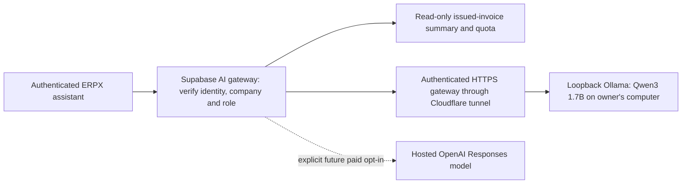

# AI architecture and free local pilot

Updated 2026-10-29. The owner explicitly approved the protected temporary public
gateway and publication. The Cloudflare tunnel is active, the five reviewed
server secrets are configured with paid use disabled, and the AI backend and
provider-aware frontend are published. Three real Arabic local inference checks
passed earlier. The separate hosted acceptance test also passed: the published
UI rendered one actual Arabic model answer for an empty, isolated test company.
This verifies that tested path, not continuous availability or broad answer
accuracy.



## Current capabilities

- `supabase/functions/ai/` separates request handling, provider configuration,
  provider transport and invoice aggregation. The browser cannot choose a
  provider, model, URL, company, role or secret through a chat request.
- Requests use the caller's Supabase JWT and verified active company membership.
  Only the configured allowed business roles can ask questions or view model
  status. Inference consumes the existing server integration quota.
- The context is the newest 1,000 eligible issued/sent/partial/paid/overdue
  invoices, with a verified eligible count and truthful truncation. Decimal
  amounts are aggregated with integer minor units; currencies remain separate
  and credit notes reduce totals. Raw customer records are not sent.
- This is not a ledger, profit, forecast, inventory or HR data connection. The
  model has no tools for executing payments, editing records or sending messages.
- Chat history is currently per-browser-component memory, not durable company
  knowledge. Each request is self-contained; semantic search, documents and
  cross-module retrieval are future work.
- Status checks installed-model gateway readiness without generating tokens.
  A successful generated reply, not the status badge, confirms actual inference.
  The UI identifies the model and distinguishes disconnected/error states.

## Local installation

Installation and the initial model pull are one-time setup, not restart steps.

The selected machine has approximately 15.3 GiB RAM, a Ryzen 7 5700U CPU and
integrated graphics. The initial model is `qwen3:1.7b` (about 1.4 GB); model
generation has no per-request provider charge. Electricity, bandwidth, existing
hosting quotas and the need for a running computer still apply.

Portable Ollama 0.40.12 CPU files are under ignored `.tmp/ai-runtime/ollama`.
Selected members came from the official HTTPS release archive and passed ZIP
CRC32 checks; the complete 1.6 GB archive was not downloaded or SHA-256 verified.
The main executable and required native binaries/libraries checked before use
have valid Ollama Inc. Authenticode signatures. Cloudflared 2026.10.5 passed its
full official release SHA-256 check and now runs the approved temporary tunnel.

```powershell
# Install the reviewed portable files, without a system-wide installer:
python scripts/ai/download-runtime.py --install

# Start only loopback Ollama and the authenticated loopback gateway:
powershell.exe -NoProfile -ExecutionPolicy Bypass -File scripts/ai/start-local-ai.ps1

# Initial model download (the running server controls the workspace model path):
.\.tmp\ai-runtime\ollama\ollama.exe pull qwen3:1.7b
```

Startup creates `.tmp/ai-runtime/gateway.private.json` with a cryptographic
32-byte bearer credential. Its Windows ACL is restricted to the owner and
SYSTEM before the secret is written. The runtime/model/private files are not
committed or uploaded. Do not print or share that file.

Ollama listens on `127.0.0.1:11434`; its cloud feature is disabled. The Node
gateway listens on `127.0.0.1:11435`. Only authenticated `GET /health` and
`POST /api/chat` exist. The gateway fixes the model and upstream URL, accepts
system/user text only, disables thinking/streaming/tools, and controls generation
parameters: 512 output tokens, 4,096 context tokens, temperature 0.2, one inference
at a time and a 90-second deadline. Request/response limits and sanitized errors
apply. It never forwards the gateway bearer to Ollama.

## Approved connection to the website

The hosted Supabase function cannot reach a laptop's loopback address. The
published connection uses an authenticated gateway through a Cloudflare Quick
Tunnel. A public HTTPS origin is created for the gateway, not for the raw Ollama
administration API. Requests without the private bearer are refused before
inference. Supabase retains the existing hosted company database; only model
inference runs locally, with HTTPS transport through the active protected tunnel.

This is a temporary pilot without an SLA. The laptop, Ollama, the gateway,
Cloudflared and the network must remain running and connected. Quick Tunnel
hostnames change on restart and have no uptime guarantee. A stable managed
endpoint or an explicitly selected hosted model is the next step for continuous
multi-user operation. Restarting the tunnel requires updating the gateway
connection in Supabase.

The approved connection and publication were applied on 2026-10-29. Exactly the
following five reviewed server settings are live; private values remain outside
the repository. The helpers' offline plans and mocked tests do not expose a
service or change provider settings:

```dotenv
AI_PROVIDER=ollama
AI_ALLOW_PAID_PROVIDER=false
OLLAMA_BASE_URL=<approved-authenticated-https-gateway-origin>
OLLAMA_API_KEY=<private-gateway-bearer>
OLLAMA_MODEL=qwen3:1.7b
```

These are server secrets, never `VITE_*` browser values. Local-only startup never
publishes them. Switching to a paid OpenAI provider later requires all of
`AI_PROVIDER=openai`, `AI_ALLOW_PAID_PROVIDER=true`, `OPENAI_API_KEY` and an
explicit `OPENAI_MODEL`; there is no automatic paid fallback when local inference
is offline. This changes server configuration without changing the browser API.

## Operation and restart

The local services and protected tunnel were left running after acceptance so
the published assistant can continue using them. Routine operation of this same
reviewed connection is within the owner's existing approval. Run the commands
below from `C:\Users\LENOVO\erpx-ai`.

These commands only show offline plans:

```powershell
powershell.exe -NoProfile -ExecutionPolicy Bypass -File scripts/ai/connect-site.ps1
python scripts/ai/publish-connection.py --plan
powershell.exe -NoProfile -ExecutionPolicy Bypass -File scripts/ai/stop-local-ai.ps1
```

For an intentional restart, stop the recorded services first, start loopback
Ollama and the authenticated gateway, create the protected temporary tunnel, then
republish the exact five reviewed settings. After a laptop restart or tunnel
restart, the new tunnel origin must be published; the old remote origin does not
update itself. Do not repeat the runtime installation or model download.

```powershell
# Stop this project's recorded, ownership-verified processes only:
powershell.exe -NoProfile -ExecutionPolicy Bypass -File scripts/ai/stop-local-ai.ps1 -Apply

# Start the local services; this step alone does not expose them publicly:
powershell.exe -NoProfile -ExecutionPolicy Bypass -File scripts/ai/start-local-ai.ps1

# Start the protected temporary tunnel, then update the five server settings:
powershell.exe -NoProfile -ExecutionPolicy Bypass -File scripts/ai/connect-site.ps1 -Apply
python scripts/ai/publish-connection.py --apply
```

`connect-site.ps1` defaults to an offline plan; `-Apply` starts the tunnel and
does not publish secrets. `publish-connection.py` defaults to an offline plan;
`--apply` publishes only the five settings listed above, using the recorded
gateway and tunnel configuration. It does not change the database or frontend.

To stop serving local inference, use `stop-local-ai.ps1 -Apply`. It stops only
the recorded and ownership-verified tunnel, gateway and Ollama processes. It
leaves all remote Supabase settings unchanged, so the published assistant will
be unavailable until services are restarted and the new connection is published.
If a helper reports an ownership/configuration mismatch or an uncertain publish
outcome, inspect that state before retrying; do not force-stop unrelated
processes or print the private gateway file.

## Evidence and remaining checks

- Fresh metadata at 13:30 UTC on October 29 identifies the active AI function as
  version 9 with JWT verification enabled.
- Frontend release `erpx-20261028T115053746Z-48c4d95d69` is published at
  https://code-376hkg8u8-isamiciari-5169s-projects.vercel.app and the stable origin
  https://code-isamiciari-5169s-projects.vercel.app. Its audited output contains
  70 payload files, 71 files including the release marker, totaling 1,701,637
  bytes. Initial asset verification and remote SHA-256 verification of all 70
  payload files passed.
- App suite: 306 tests in 29 files passed; TypeScript passed.
- Edge tests: 25 mocked Deno checks passed; cached Deno type check passed.
- Gateway: 18 offline boundary tests passed; Edge deploy tooling: 8 mocked tests
  passed with the new exact six-file AI runtime inventory.
- Real model smoke test: three Arabic answers using synthetic invoices only.
  Manual review matched two invoices, total/collected 345 SAR and VAT 45 SAR;
  the model stated employee data was absent and it could not execute payments
  or edit records. Recorded durations were 8.3 s, 1.2 s and 2.7 s. This is a small
  functional sample, not a broad model-quality or adversarial benchmark.
- Private evidence: `.tmp/ai-runtime/local-inference-report.json` and
  `download-manifest.json`. No paid provider was called and no live company
  information was used in these generation tests.
- Hosted acceptance passed on 2026-10-29 through
  `scripts/ai/verify-published-ai.mjs`, using a separate company and two test
  identities from `.tmp/ai-runtime/acceptance.private.json`. Anonymous access
  returned 401, cashier access 403, and the administrator's status returned 200
  with the exact local model and read-only contract. Provider/model/company
  override attempts each returned 400.
- The actual published `/finance/ai-assistant` UI rendered one Arabic answer
  that explicitly stated zero/no issued invoices, with model identity
  `qwen3:1.7b`. Browser errors and blocked requests were both zero. Invoices,
  sales, payments and journal entries were empty before and after; exactly one
  chat was sent. No original business company was used.
- Hosted evidence: `.tmp/ai-runtime/published-ai-verification.json` and
  `published-ai-verification.masked.png`, for isolated run
  `20261029T132657Z-6edf506741c0`. The screenshot contains only the assistant
  section and permitted synthetic-company answer, with the question field
  masked. Credentials, tokens, raw HTTP payloads and trace files are not saved.
  The runner's offline plan and nine unit checks also passed separately.
- The new AI acceptance fixture was finalized successfully after the test. An
  independent read-only check at 13:33:05 UTC confirmed the company and tenant
  suspended, both ERP users and both profiles suspended, both Auth accounts
  banned, and exactly one matching finalization audit. All ten checked financial,
  catalog, stock and shift table counts were zero. Evidence:
  `.tmp/supabase-review/ai-finalization-verification-20261029.json`. The private
  fixture receipt is `finalized` and must not be reused.
- A fresh read-only preservation check after finalization confirmed all 193
  original rows across 43 tables. Values in 42 tables matched exactly; the
  original warehouse retained only the previously reviewed routing changes.

Official references reviewed on 2026-10-28:

- [Ollama Windows portable runtime](https://docs.ollama.com/windows)
- [Qwen3 1.7B model and Apache 2.0 license](https://ollama.com/library/qwen3:1.7b)
- [Ollama chat API](https://docs.ollama.com/api/chat)
- [Cloudflare Quick Tunnel limitations](https://developers.cloudflare.com/tunnel/get-started/quick-tunnels/)
- [OpenAI API pricing for a later hosted option](https://developers.openai.com/api/docs/pricing)
- [Gemini free-tier data use, considered but not selected](https://ai.google.dev/gemini-api/docs/pricing)
